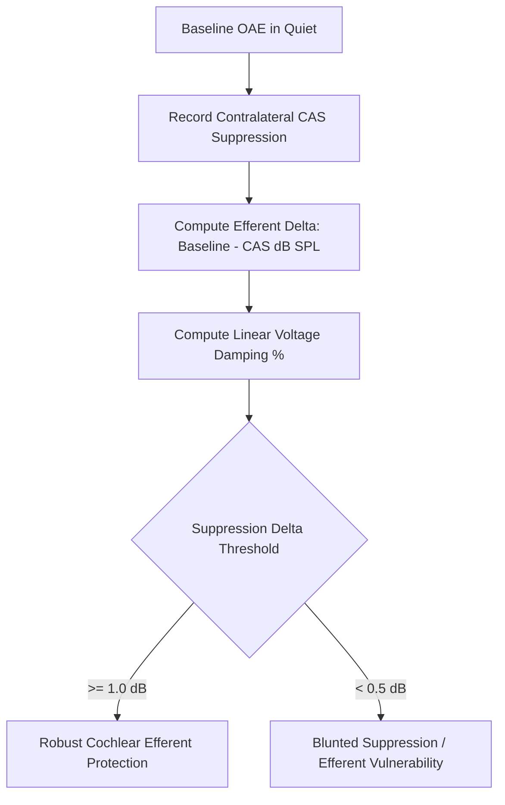

# Medial Olivocochlear (MOC) Efferent Acoustic Reflex Skill

[](LICENSE)
[](https://www.python.org/)
[](https://openclaw.org/)
[](https://alphapark.ai/)
[](https://modelcontextprotocol.io/)

Medial Olivocochlear (MOC) Efferent Acoustic Reflex and Contralateral OAE Suppression Analyzer based on auditory biophysics.



## Features
- **Zero PIP Dependencies**: Implemented strictly with Python Standard Library (`math`, `json`, `sys`, `typing`).
- **Acoustic Efferent Modeling**: Quantifies outer hair cell electromotility damping under contralateral noise.
- **Artifact Protection**: Checks for acoustic middle-ear stapedial reflex contamination at high sound levels.
- **Dual Architecture**: Native Python import and Model Context Protocol (MCP) JSON-RPC 2.0 stdio server.

## Quickstart
```bash
python example_usage.py
```

## License
Apache-2.0
